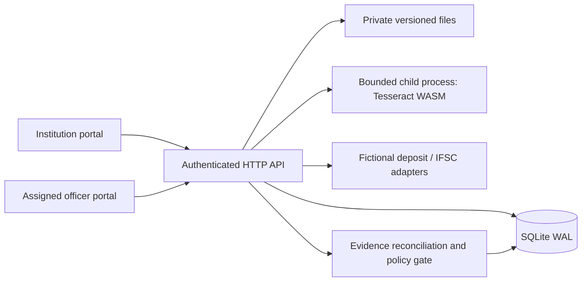

> Current status: see [audit update](../audit-status-update.md) and [completion report](../phase-1-2-completion-report.md). Baseline descriptions below are retained for history.

# System overview
A single loopback Node.js service serves HTML/CSS/JS and JSON APIs. SQLite WAL stores users, sessions, institution profiles, cases, append-only evidence, durable processing states and audit events. UUID-named private files live outside the served asset directory.

No extra queue, Redis, containers or cloud service is required. OCR runs in a child process (60-second timeout, bounded output, at most two processing jobs) and uses local models. Jobs persist processing/completed/failed/superseded/interrupted states. Startup marks abandoned jobs interrupted; operators can explicitly retry. This is not a distributed queue with automatic retries.

Regulatory evaluation is gated by trusted configuration, effective dates, scope, verification metadata and recognized operators. The active registry has no verified AICTE rule. UI and engine preserve human authority. See policy tests for synthetic-only rule behavior.
